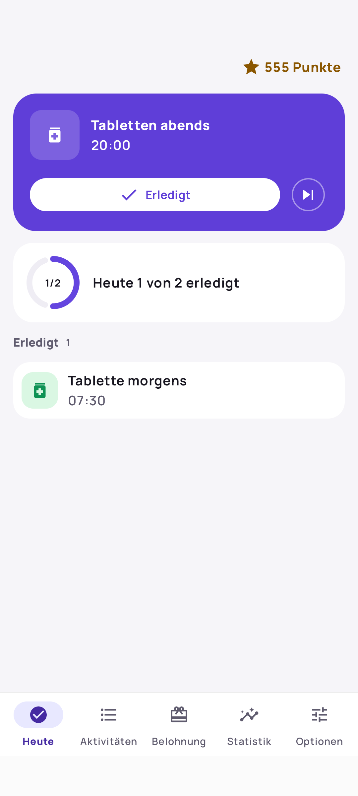
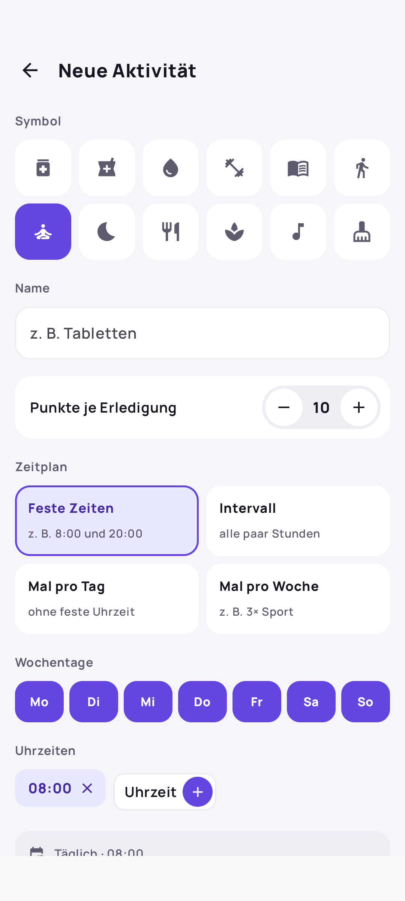
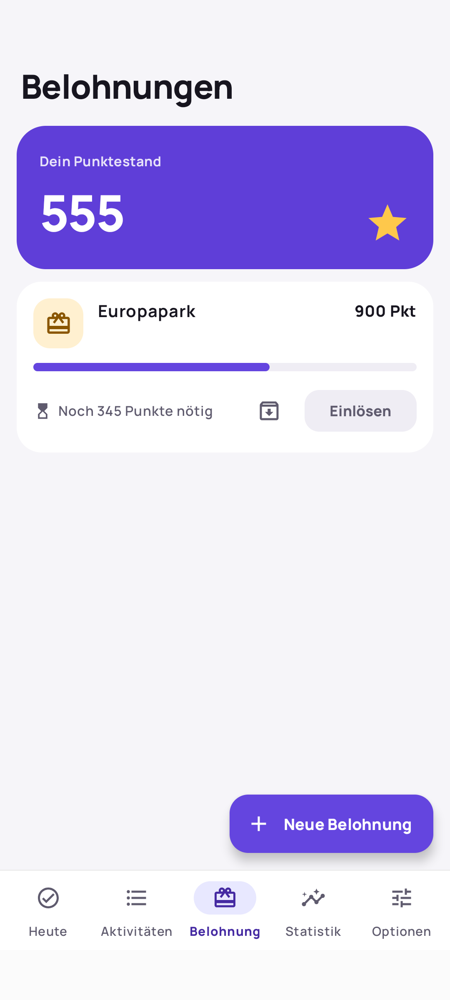
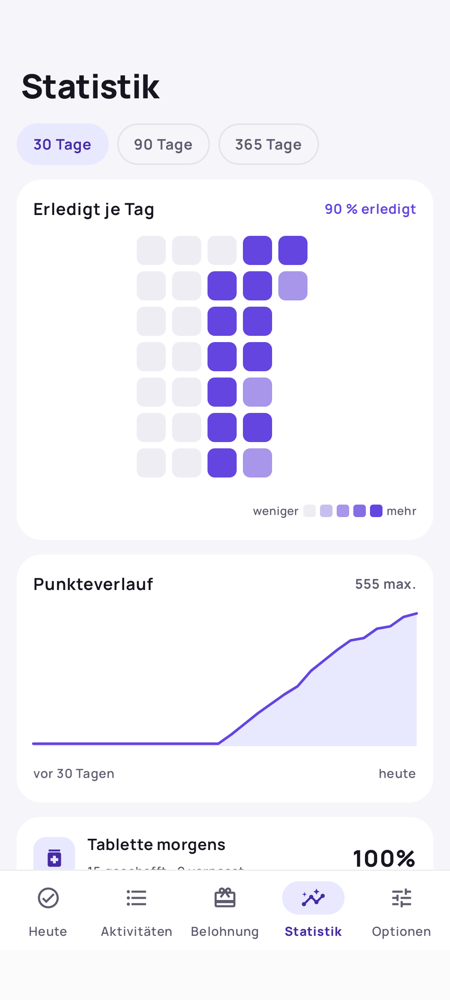
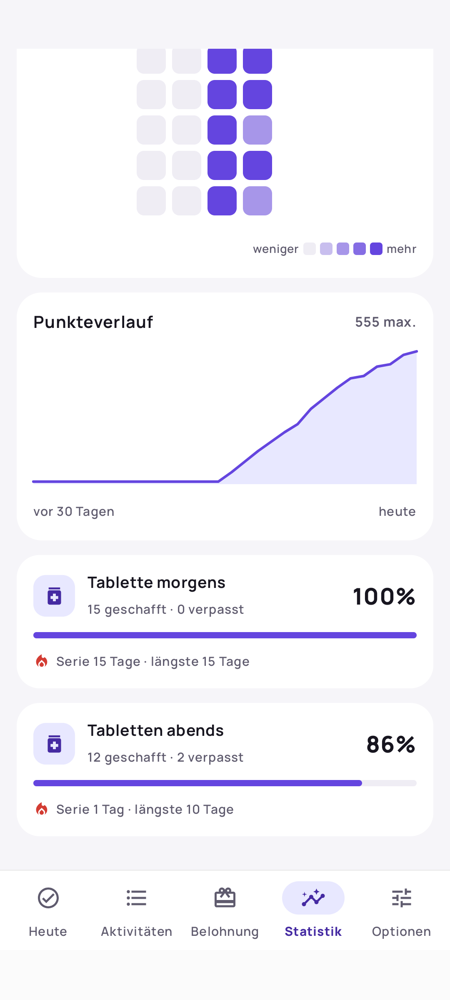

# Tagwerk

Erinnerungen für alles, was regelmäßig ansteht: Tabletten morgens und abends, Medizin zum
Mittagessen, dreimal die Woche Sport, die Steuererklärung bis Ende Mai. Jede Erledigung bringt
Punkte, und die Punkte gibst du für Belohnungen aus, die du dir selbst gesetzt hast.

Tagwerk läuft vollständig auf dem Handy: kein Server, kein Konto, nicht einmal eine
Internet-Berechtigung.

**Download:** Die aktuelle APK liegt unter [Releases](../../releases/latest).

<table>
  <tr>
    <td align="center"></td>
    <td align="center"></td>
    <td align="center"></td>
  </tr>
  <tr>
    <td align="center"><b>Heute</b> die nächste fällige Aktivität, Tagesfortschritt und Erledigtes</td>
    <td align="center"><b>Neue Aktivität</b> Symbol, Punkte, Zeitplan, Wochentage und Uhrzeiten</td>
    <td align="center"><b>Belohnungen</b> Punktestand und wie viel bis zur nächsten Belohnung fehlt</td>
  </tr>
  <tr>
    <td align="center"></td>
    <td align="center"></td>
    <td></td>
  </tr>
  <tr>
    <td align="center"><b>Statistik</b> Heatmap je Tag und Punkteverlauf</td>
    <td align="center"><b>Je Aktivität</b> Quote, geschafft und verpasst, aktuelle und längste Serie</td>
    <td></td>
  </tr>
</table>

## Die Bereiche

**Heute.** Oben der Punktestand und groß die nächste fällige Aktivität mit *Erledigt* und
*Auslassen*, darunter der Tagesfortschritt („Heute 1 von 2 erledigt“) und die übrigen
Aktivitäten als Kacheln mit Symbol. Erledigen und Auslassen lässt sich direkt per Toast
rückgängig machen, später auch noch über *Wieder öffnen* im Bereich „Erledigt“. Offene
Einmalaufgaben stehen mit den Tagen bis zur Deadline im Bereich „Aufgaben“.

**Aktivitäten.** Alle Aktivitäten mit Symbol, Plan („Täglich · 08:00, 20:00“), Punkten und
aktueller Serie, Einmalaufgaben in einem eigenen Abschnitt. Im Editor wählst du Symbol, Name,
Punkte je Erledigung, die Art des Zeitplans, Wochentage und Uhrzeiten und siehst am Ende eine
Zusammenfassung des Plans.

**Belohnungen.** Dein Punktestand und die Belohnungen, die du dir gesetzt hast. Ein Balken zeigt,
wie viele Punkte noch fehlen. Auf Wunsch hat eine Belohnung eine Bedingung (eine Mindestserie
oder ein Startdatum). Eingelöste Belohnungen erscheinen im Verlauf und lassen sich rückgängig
machen.

**Statistik.** Für die letzten 30, 90 oder 365 Tage: eine Heatmap, wie viel an jedem Tag erledigt
wurde, die Gesamtquote, der Punkteverlauf als Diagramm und pro Aktivität Quote, Anzahl geschafft
und verpasst sowie aktuelle und längste Serie.

**Optionen.** Tagesbonus, Kulanzfenster für feste Uhrzeiten und was ein zu spät abgehakter Termin
noch bringt (volle, halbe oder keine Punkte). Hell oder Dunkel, Export und Import eines Backups.

**Widget.** Das Homescreen-Widget „Heute“ zeigt Fortschritt und Punktestand und bis zu vier
fällige Aktivitäten, die sich direkt dort abhaken lassen.

## Was die App kann

**Fünf Arten von Zeitplan.**

- Feste Uhrzeiten an ausgewählten Wochentagen – Tabletten Mo–So um 8:00 und 20:00.
- Intervalle in einem Zeitfenster – alle drei Stunden zwischen 8:00 und 22:00.
- Tagesziele ohne feste Uhrzeit – dreimal täglich.
- Wochenziele – dreimal die Woche Sport.
- Einmalaufgaben mit Deadline – Punkte gibt es nur bis zur Deadline. Auf Wunsch erinnert die App
  wöchentlich und in den letzten vier Wochen zweimal pro Woche.

**Erinnerungen, die ankommen.** Die Benachrichtigung hat die Knöpfe *Erledigt*, *Später* und
*Ausgelassen* und lässt sich direkt aus der Statusleiste beantworten. Bleibt sie unbeantwortet,
fasst die App nach. Eine verpasste Erinnerung, etwa nach einem Neustart, wird nachgeholt statt
übersprungen – bei Medikamenten ist spät besser als gar nicht.

**Sagt Bescheid, wenn etwas blockiert.** Fehlen Benachrichtigungsrechte, sind exakte Alarme nicht
erlaubt oder bremst die Akkuoptimierung des Herstellers, erscheint auf *Heute* ein Hinweis mit
direktem Sprung in die passende Systemeinstellung. Tagwerk scheitert nie stillschweigend.

**Punkte, die sich erklären lassen.** Jede Erledigung, jeder Bonus und jede Einlösung ist ein
eigener Eintrag mit Betrag, Zeitpunkt und Grund. Rückgängig machen bucht eine Gegenbuchung, der
Verlauf bleibt nachvollziehbar.

**Serien und Boni.** Eine Serie zählt in Tagen, bei Wochenzielen in Wochen. Ein bewusst
ausgelassener Tag bricht sie nicht, verlängert sie aber auch nicht. Für Serienschwellen gibt es
Bonuspunkte, dazu einen Tagesbonus, wenn alles erledigt ist.

**Backup.** Alle Daten lassen sich als JSON-Datei exportieren und wieder einspielen, etwa beim
Wechsel auf ein neues Handy.

## Voraussetzungen

Android 13 oder neuer.
